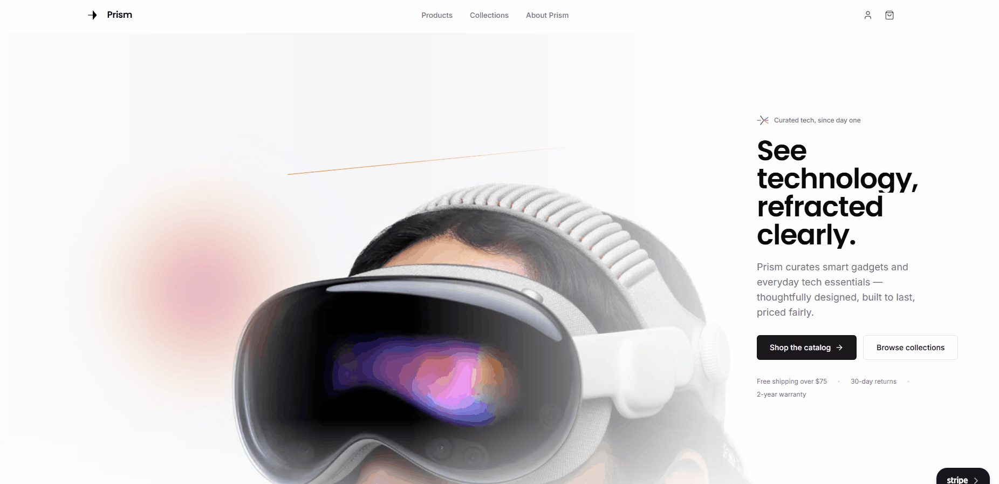
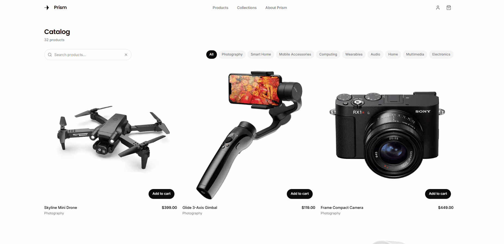
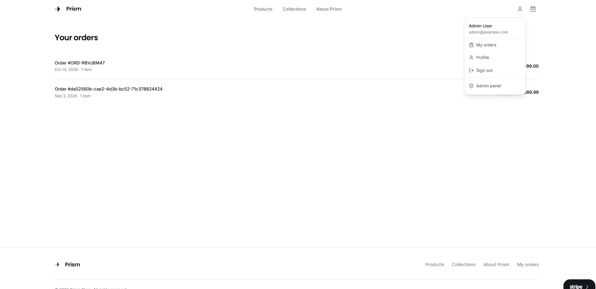
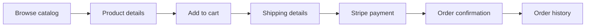

<div align="center">


# Prism

**See technology, refracted clearly.**

A polished e-commerce storefront for smart gadgets and everyday tech essentials,
built with Next.js and designed around a calm, editorial shopping experience.


[Preview](#preview) · [Features](#features) · [Tech Stack](#tech-stack) · [Getting Started](#getting-started) · [Configuration](#configuration) · [Testing](#testing) · [Docker](#docker)

</div>

---

## Table of Contents

- [Overview](#overview)
- [Preview](#preview)
- [Features](#features)
- [Tech Stack](#tech-stack)
- [Getting Started](#getting-started)
- [Configuration](#configuration)
- [Available Scripts](#available-scripts)
- [Testing](#testing)
- [Product & Checkout Flow](#product--checkout-flow)
- [Routes](#routes)
- [Project Structure](#project-structure)
- [Docker](#docker)
- [Engineering Practices](#engineering-practices)
- [License](#license)

## Overview

Prism is a full-featured e-commerce frontend for discovering, comparing, and purchasing thoughtfully selected technology products. It combines a modern storefront with customer account management, a Stripe-powered checkout, and an administration workspace.

The project focuses on responsive design, reusable components, typed API integration, and clear user interactions across the whole shopping experience.

> **Note:** this repository contains the **frontend only**. It requires a running Prism API service (see [Prerequisites](#prerequisites)).

## Preview

<!--
  GIF tips:
  - Keep each recording under ~15 seconds and ~8 MB.
  - Record at ~1280px wide and export at 800–900px.
  - Save them in docs/assets/ with the file names used below.
-->

### Storefront & product discovery

Browse the landing page, search the catalog, apply filters, and open a product's detail page.

<p align="center">
  
</p>

### Purchase flow

From adding a product to the cart, through shipping details and Stripe payment, to the order confirmation.

<p align="center">
  
</p>

### Admin workspace

Manage products, categories, orders, and users, upload images, and process refunds.

<p align="center">
  
</p>

## Features

| Area                        | What's included                                                                                              |
| --------------------------- | ------------------------------------------------------------------------------------------------------------ |
| **Editorial storefront**    | Responsive landing page, featured products, collections, trust messaging, and newsletter signup.             |
| **Product discovery**       | Search, category filters, pagination, loading states, product cards, and detailed product pages.             |
| **Authentication**          | Login, registration, persisted sessions, and automatic access-token refresh.                                 |
| **Cart & checkout**         | Quantity controls, shipping details, Stripe Elements integration, and order confirmation.                    |
| **Customer accounts**       | Profile updates, password management, order history, and order details.                                      |
| **Admin workspace**         | Product, category, user, and order management, image uploads, and refund workflows.                          |
| **Responsive interactions** | Framer Motion animations, accessible labels, keyboard-friendly controls, and clear disabled states.          |
| **Automated tests**         | Vitest and React Testing Library tests for validation utilities, Zustand stores, and selected UI components. |

## Tech Stack

| Layer              | Technology                           |
| ------------------ | ------------------------------------ |
| Framework          | Next.js 16, App Router               |
| UI                 | React 19, Tailwind CSS 4             |
| Language           | TypeScript                           |
| State management   | Zustand                              |
| Animations         | Framer Motion                        |
| Icons              | Lucide React                         |
| Payments           | Stripe Elements                      |
| Product images     | Cloudinary                           |
| Testing            | Vitest, React Testing Library        |
| Production runtime | Node.js 22, Docker standalone output |

## Getting Started

### Prerequisites

- Node.js 22 or newer
- npm
- A running Prism API service
- A Stripe publishable key for payment checkout

### Installation

```bash
# 1. Clone the repository and enter the frontend directory
git clone <repository-url>
cd prism-ecommerce/prism_web

# 2. Install dependencies
npm install

# 3. Create your local environment file
cp .env.example .env.local

# 4. Start the development server
npm run dev
```

Then open [http://localhost:3000](http://localhost:3000).

> If `.env.example` is not present in your checkout, create `.env.local` manually using the variables described in [Configuration](#configuration).

## Configuration

The frontend communicates with the Prism API through a centralized typed client in `src/libs/api.ts`.

Browser requests use `NEXT_PUBLIC_API_URL`. Server-side requests can use `INTERNAL_API_URL` when the API is reachable through a private Docker network or another internal address.

```dotenv
# Public API origin used by the browser
NEXT_PUBLIC_API_URL=http://localhost:4000

# Optional server-only API origin
INTERNAL_API_URL=http://localhost:4000

# Stripe publishable key
NEXT_PUBLIC_STRIPE_PUBLISHABLE_KEY=pk_test_your_key_here
```

| Variable                             | Required | Description                                                                    |
| ------------------------------------ | :------: | ------------------------------------------------------------------------------ |
| `NEXT_PUBLIC_API_URL`                |    ✅    | API origin used by the browser, without a trailing endpoint path.              |
| `INTERNAL_API_URL`                   |    ➖    | Server-only API origin. Falls back to `NEXT_PUBLIC_API_URL`.                   |
| `NEXT_PUBLIC_STRIPE_PUBLISHABLE_KEY` |    ✅    | Required for payment checkout. Must also be available during the Docker build. |

### Notes

- Authentication tokens are persisted in browser `localStorage`. The API client retries an unauthorized request once after attempting to refresh the access token.
- Never expose Stripe secret keys or other server-side credentials through `NEXT_PUBLIC_` variables.

## Available Scripts

| Command              | Description                  |
| -------------------- | ---------------------------- |
| `npm run dev`        | Start the development server |
| `npm run lint`       | Run ESLint                   |
| `npm test`           | Run the test suite once      |
| `npm run test:watch` | Run tests in watch mode      |
| `npm run build`      | Create a production build    |
| `npm run start`      | Serve the production build   |

## Testing

Prism uses Vitest and React Testing Library to verify critical frontend behavior. The current suite contains **97 tests across 10 test files**, covering:

- Input validation utilities
- Authentication, cart, and checkout stores
- Authentication form components
- Product cards, filters, and add-to-cart interactions
- The admin product form

```bash
npm test            # run the test suite once
npm run lint        # lint checks
npm run build       # production build
```

The suite focuses on representative business logic and critical user interactions rather than aiming for blanket coverage of every page and component.

## Product & Checkout Flow



1. Visitors explore featured products or open the catalog.
2. Search and category filters update the catalog URL.
3. Products can be added to the cart from product cards or detail pages.
4. Customers provide shipping details and proceed to Stripe payment.
5. Successful payments lead to order confirmation through the API.
6. Authenticated customers can review their orders and open individual order details.

Stripe Elements handles sensitive payment fields in the browser. The API coordinates payment intents and order state.

## Routes

<details>
<summary><strong>Storefront</strong></summary>

| Route            | Purpose                                  |
| ---------------- | ---------------------------------------- |
| `/`              | Landing page                             |
| `/products`      | Catalog, search, filters, and pagination |
| `/products/[id]` | Product details and add-to-cart controls |
| `/collections`   | Product collections                      |
| `/about`         | About Prism                              |
| `/cart`          | Shopping cart                            |

</details>

<details>
<summary><strong>Customer account & checkout</strong></summary>

| Route               | Purpose                         |
| ------------------- | ------------------------------- |
| `/login`            | Sign in                         |
| `/register`         | Create an account               |
| `/profile`          | Profile and password management |
| `/orders`           | Order history                   |
| `/orders/[id]`      | Order details                   |
| `/checkout`         | Shipping and checkout review    |
| `/checkout/payment` | Stripe payment                  |
| `/checkout/success` | Order confirmation              |

</details>

<details>
<summary><strong>Administration</strong></summary>

| Route                  | Purpose                      |
| ---------------------- | ---------------------------- |
| `/admin`               | Admin dashboard              |
| `/admin/products`      | Product management           |
| `/admin/products/new`  | Create a product             |
| `/admin/products/[id]` | Edit a product               |
| `/admin/categories`    | Category management          |
| `/admin/orders`        | Order management and refunds |
| `/admin/users`         | User management              |

</details>

## Project Structure

```text
src/
├── app/                    # App Router pages and route-level UI
├── components/
│   ├── modules/            # Feature components grouped by domain
│   │   ├── admin/
│   │   ├── auth/
│   │   ├── cart/
│   │   ├── collections/
│   │   ├── landing/
│   │   ├── order/
│   │   ├── product/
│   │   └── profile/
│   └── ui/                 # Shared presentation primitives
├── libs/
│   ├── api.ts              # Typed API client and token refresh
│   ├── analytics.ts        # Analytics helpers
│   ├── types.ts            # Shared domain types
│   └── validation.ts       # Client-side validation
└── store/                  # Zustand stores for auth, cart, checkout
```

## Docker

The application uses Next.js standalone output to produce a production image containing only the files required at runtime. The Dockerfile uses a three-stage build and runs the final process as a non-root user.

```bash
# Build with the public build-time variables
docker build \
  --build-arg NEXT_PUBLIC_API_URL=https://api.example.com \
  --build-arg NEXT_PUBLIC_STRIPE_PUBLISHABLE_KEY=pk_live_your_key_here \
  -t prism-web .

# Run on port 3000
docker run --rm -p 3000:3000 prism-web
```

Replace the example API URL and Stripe key with the values for your deployment.

## Engineering Practices

- Keep feature-specific UI inside its corresponding domain module.
- Use the typed API client rather than calling `fetch` directly from components.
- Keep state management focused on the responsibilities of each Zustand store.
- Preserve responsive layouts and accessible interaction patterns.
- Test critical business logic and user-facing component behavior.
- Run lint, tests, and the production build before merging changes.

## License

This project is intended for the Prism e-commerce application. No open-source license is currently declared.

---

<div align="center">
  <sub>Built with Next.js, React, and a lot of care for the details.</sub>
</div>
